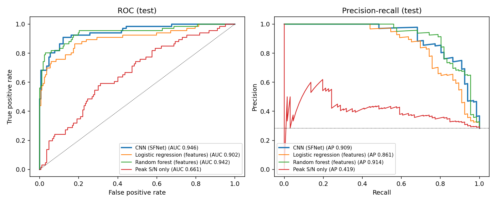
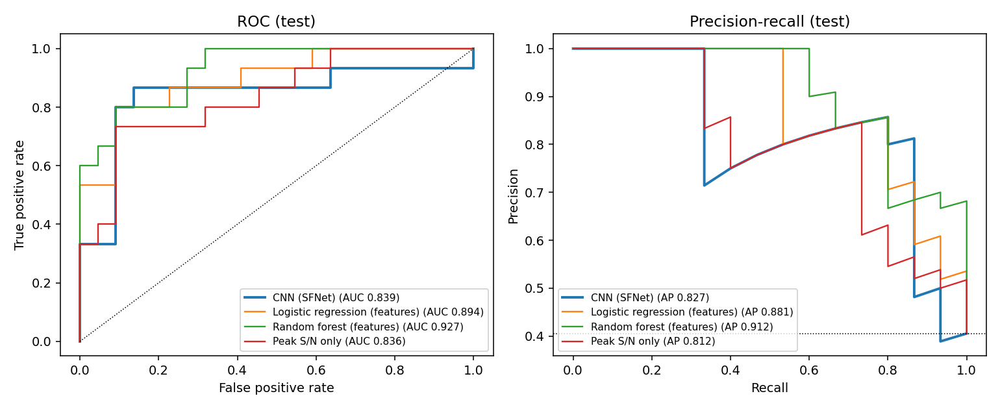
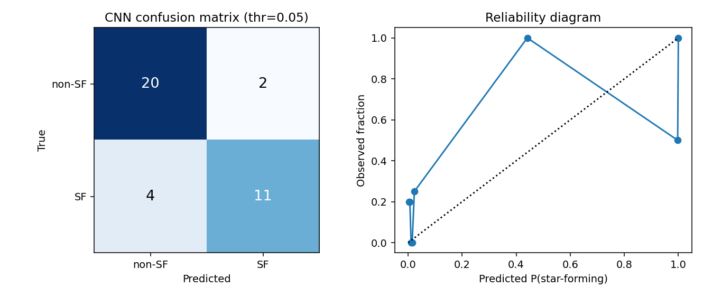
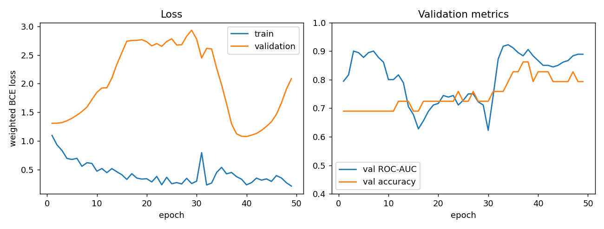
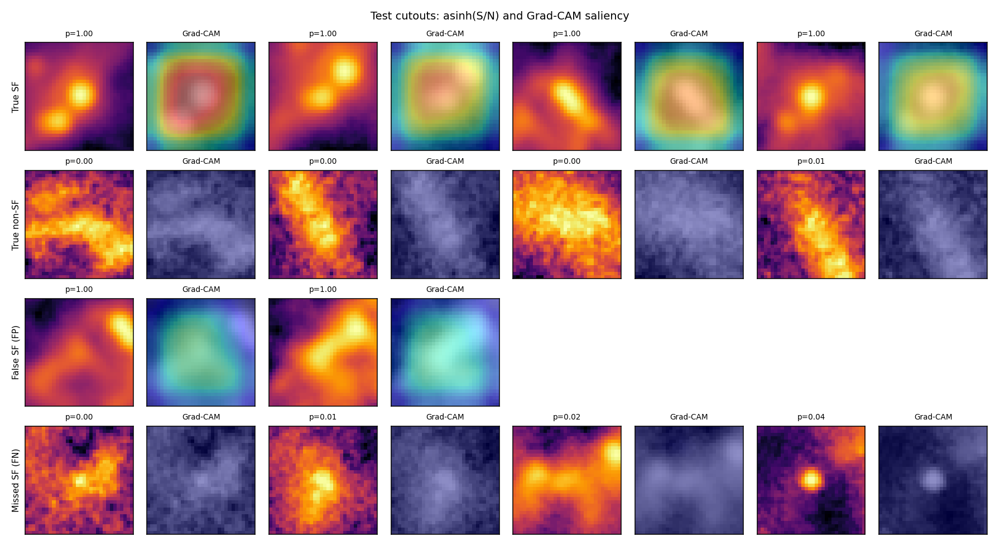
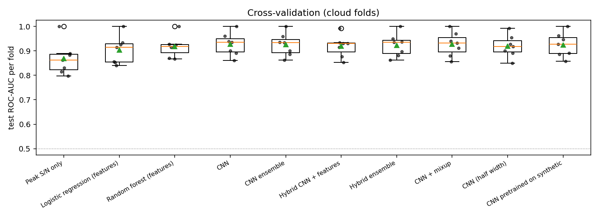
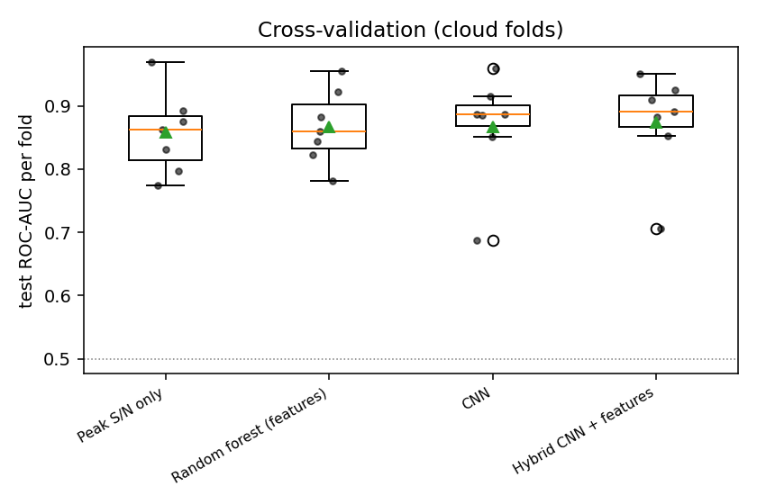
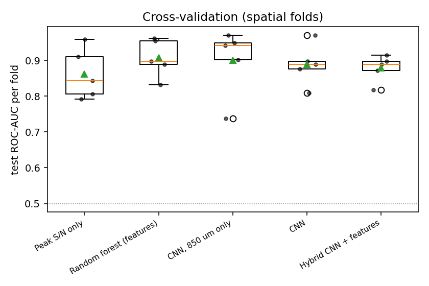

# Classifying Star-Forming and Non-Star-Forming Dense Cores in JCMT SCUBA-2 Maps with a Convolutional Neural Network

*Revisiting my 2023 final-year project: code and report*

### Background
This project started as my BSc final-year project at Universiti Sains Malaysia (USM) in 2023,
*Machine Learning Applications for the James Clerk Maxwell Telescope*
([original code](original_2023/sfcnn_2023.ipynb), reconstructed from the thesis appendix
because the Colab notebook no longer exists). That version trained a simple Keras CNN on 150 PNG
images from the JCMT Transient Survey, using a random split and reporting accuracy on the
validation set.

Looking back, my knowledge at the time was limited. I converted the data to images and lost
the physical information. The labels weren't well defined. I had no baselines to compare
against, and there was no proper held-out test, so I couldn't tell whether the model had
learned anything real.

The original Colab notebook is no longer available. Since 2023 I've learned a lot more about
machine learning and astronomical data, so in 2026 I decided to build the project again, and
better this time. I developed it locally on my laptop and uploaded it to GitHub once it was
working, which is why the commit history is short. This version works directly on SCUBA-2
FITS maps from 8 Gould Belt clouds. It labels cores automatically from YSO catalogues,
compares the CNN against classical baselines, and tests every model on clouds it has never
seen. The results are more modest than the original 0.92 accuracy, but they are far more
trustworthy, and the report below explains why.

---

## Abstract

Dense cores in molecular clouds are where stars form, but deciding whether a given core
already contains a protostar normally requires infrared observations. This project asks
whether a convolutional neural network (CNN) can make that call from submillimetre
dust-continuum data alone. Cutouts come from James Clerk Maxwell Telescope (JCMT) SCUBA-2
850 µm maps. The pipeline detects cores, labels them by cross-matching against Spitzer
young-stellar-object (YSO) catalogues, extracts unit-free 32 × 32 cutouts, and trains a
compact CNN (SFNet, 0.3 M parameters) with rotation/flip augmentation and leakage-aware
train/test splits.

The method was developed on a synthetic survey (868 cores), where SFNet reached ROC-AUC 0.946
on held-out regions. A first real-data test on Perseus alone (181 cores, one 37-core test
set) gave AUC 0.84: no better than peak S/N, and below a random forest on six hand-crafted
features (0.93).

The study was then extended to **eight Gould Belt clouds (882 labelled cores, 175
star-forming)** and evaluated with **leave-one-cloud-out cross-validation**, in which every
model is tested on a cloud it has never seen. Two methodological fixes were needed:
- a YSO-coverage cut, without which Serpens E (outside the Spitzer footprint) was mislabelled
  as entirely starless;
- a minimum training length before early stopping.

Across 7 test clouds the CNN reached a mean ROC-AUC of **0.927 ± 0.046**, against 0.917 for
the random forest, 0.903 for logistic regression and 0.868 for peak S/N. The CNN beat peak
S/N in 6 of 7 clouds (Wilcoxon p = 0.03), so with enough training data it learns more than
brightness. Its lead over the random forest is not significant (p = 0.22). None of the
refinements tested improved on the plain CNN by more than the fold-to-fold scatter:
seed ensembles, a hybrid CNN + features model, mixup, a half-width network, pretraining on
synthetic maps, a 450 µm channel and physical-scale cutouts. CNN scores also shift between
clouds, which lowers the pooled AUC (0.856 vs 0.887 for the random forest). The main limits
are now label quality and the cloud-to-cloud domain shift, not network design.

---

## 1. Introduction

### 1.1 Scientific background
Stars form in dense cores (about 0.05–0.1 pc, about 10⁴–10⁵ cm⁻³) inside molecular clouds.
A central question in star formation is how long cores spend in the **starless /
prestellar** phase before a protostar forms. That timescale is estimated from the ratio of
starless to protostellar cores (e.g. Ward-Thompson et al. 2007), so it depends on
classifying large numbers of cores correctly.

Cold dust in cores emits in the submillimetre, and JCMT's SCUBA-2 camera maps this emission
at 450 and 850 µm (Holland et al. 2013). Protostars, however, are usually identified in the
mid/far-infrared from their spectral energy distributions: the spectral index α and the
bolometric temperature T_bol (Greene et al. 1994; Chen et al. 1995; Dunham et al. 2015).
If 850 µm morphology alone could predict whether a core is star-forming, the method would
work where infrared coverage is missing, confused or saturated. It would also show which
physical signatures in the dust emission trace star formation.

Physically we expect differences between the two classes:
- **Protostellar envelopes** are centrally condensed, with steep power-law density profiles
  (ρ ∝ r^-1.5 to r^-2) and a warm inner region, which makes a compact, peaked 850 µm source.
- **Starless and prestellar cores** have flatter inner profiles (close to Bonnor–Ebert).
- Outflow CO(3–2) emission can leak into the 850 µm band (Drabek et al. 2012) and add faint
  structure around protostars.

### 1.2 Aims
1. Build a reproducible pipeline from raw SCUBA-2 FITS maps to labelled training cutouts.
2. Train a CNN to classify cores as star-forming or non-star-forming.
3. Compare it fairly against classical baselines, using splits that prevent information leaking
   from training to test data.
4. Interpret what the CNN has learned (Grad-CAM) and identify its failure modes.
5. Test whether the classifier generalises to clouds it was not trained on, and which
   model refinements actually help.

---

## 2. Data

### 2.1 JCMT SCUBA-2 maps
Real data are the public **JCMT Gould Belt Survey (GBS) DR3** 850 µm maps of Perseus
(Kirk et al. 2018; data DOI [10.11570/18.0005](https://doi.org/10.11570/18.0005)), reduced
with the external-mask method (`extmask`):

| map | pixels | pixel scale | units |
|---|---|---|---|
| `PerseusWest_20170815_850_DR3_ext_HK` (NGC 1333, B1, L1448, L1455) | 3956 × 2570 | 3″ | mJy arcsec⁻² |
| `PerseusIC348_20170725_850_DR3_ext_HK` (IC 348, B5) | 3050 × 2341 | 3″ | mJy arcsec⁻² |

Each file contains the map and a `VARIANCE` extension. The 850 µm effective beam is 14.1″
(Dempsey et al. 2013), which is about 0.02 pc at the Perseus distance of about 300 pc.

**Multi-cloud extension.** For the cross-cloud experiments (E4–E6), the 850 µm DR3
`extmask` maps of every Gould Belt cloud covered by the Dunham et al. (2015) catalogue were
added: 20 maps in 8 clouds. The 450 µm maps were downloaded only for Perseus, because of
limited disk space. [scripts/make_gbs_manifest.py](scripts/make_gbs_manifest.py) assigns each
map to its parent cloud and an approximate distance.

| cloud | maps | distance used (pc)* | labelled cores | star-forming |
|---|---|---|---|---|
| Perseus | West, IC 348 | 300 | 164 | 49 |
| Ophiuchus | Main (N2, N3, N6 gave no cores) | 140 | 126 | 23 |
| Serpens/Aquila | Aquila, Main, N, MWC 297 (E removed, §3.2) | 436 | 375 | 50 |
| Auriga | Central, LkHα 101, North | 450 | 81 | 18 |
| Cepheus | L1228, L1251, South | 200–300 | 38 | 10 |
| IC 5146 | 1 | 750 | 64 | 18 |
| Corona Australis | 1 | 150 | 26 | 7 |
| Lupus | 1 | 155 | 8 | 0 |
| **Total** | **20** | | **882** | **175** |

\*Rounded literature values, used only for the physical-scale cutouts (E5); IC 5146 in
particular is poorly constrained (600–950 pc). *Check and cite before quoting.*

The Ophiuchus N2, N3 and N6 fields are faint: their maximum per-pixel S/N is about 7–8, so
no peak survives the 5σ detection and smoothing. Lupus has no star-forming cores, so it is
used for training but never as a test cloud.

### 2.2 YSO catalogue
Protostar positions come from the Spitzer c2d + Gould Belt catalogue of **Dunham et al.
(2015)** (VizieR `J/ApJS/220/11`, table `fluxobs`, Cloud = Perseus; 385 YSOs). Classes were
assigned from the extinction-corrected spectral index α′ and T_bol, following Dunham et al.
(2015). This is done by [scripts/prepare_dunham2015.py](scripts/prepare_dunham2015.py).

| class | rule | N (Perseus) |
|---|---|---|
| 0 | α′ ≥ 0.3, T_bol < 70 K | 37 |
| I | α′ ≥ 0.3, T_bol ≥ 70 K | 38 |
| Flat | −0.3 ≤ α′ < 0.3 | 35 |
| II | −1.6 ≤ α′ < −0.3 | 235 |
| III | α′ < −1.6 | 39 |

For the multi-cloud experiments the full table (all clouds, 2,966 YSOs) was used: 72 Class 0,
250 Class I, 210 Flat, 1,248 Class II, 1,182 Class III and 4 unclassified.

### 2.3 Synthetic survey
The pipeline needed to be developed and tested before touching real data, so
[sfcnn/synthetic.py](sfcnn/synthetic.py) generates SCUBA-2-like maps. Each map contains:
- a lognormal cloud with a power-law spectrum, plus filaments;
- flat-topped starless cores;
- centrally peaked protostellar envelopes with an unresolved warm component and optional
  CO-outflow lobes;
- realistic observing effects:
  - the two-component SCUBA-2 beam (13″ main beam + 48″ error beam);
  - loss of large scales from the map-maker (simulated by a high-pass filter);
  - noise that rises towards the map edges;
  - a matching YSO catalogue with positional scatter and unrelated Class II/III stars.

Deliberately "hard" cores were added so the task is not trivial: compact prestellar cores
and faint, VeLLO-like protostars. In total there are 12 regions of 40′ × 40′ with
868 labelled cores.

---

## 3. Method

### 3.1 Core detection
Cores are local maxima of the S/N map (data / √variance). Before peak finding, the map is
smoothed with a 7″ Gaussian. A peak is kept only if it is above 5σ and at least one beam
(15″) from a brighter peak ([sfcnn/sources.py](sfcnn/sources.py)).

### 3.2 Labelling
Each peak is cross-matched with the YSO catalogue ([sfcnn/labels.py](sfcnn/labels.py)):
- **Star-forming (1):** a Class 0, I or Flat protostar within 15″ (about one beam) of the peak.
- **Non-star-forming (0):** no protostar within 30″, and no Class II/III star within 15″.
- **Ambiguous:** everything else. These cores are discarded.

The buffer zone between the two radii keeps astrometric scatter and borderline associations
from becoming label noise. Discarding cores with a Class II/III star on the peak removes
cases where an evolved or misclassified YSO overlaps a core.

**YSO-coverage cut.** "No protostar nearby" only means "starless" where Spitzer actually
looked. When the multi-cloud dataset was first built, all 56 cores in **Serpens E** were
labelled non-star-forming. The nearest catalogued YSO of *any* class turned out to be about
57′ away: the field lies outside the Spitzer c2d/GBS footprint. A core is therefore now
dropped (label −2) if no YSO of any class lies within 10′ (`labels.coverage_radius_arcmin`).
The cut removed 90 cores: all 56 in Serpens E and 34 elsewhere, of which 17 were in
Perseus (181 → 164). The cut uses the catalogue as a proxy for the survey footprint. A proper
footprint mask would be better, but it is not part of the VizieR table.

The table below is for the original Perseus-only dataset (E2, E3), which was built before
the coverage cut existed.

| region | labelled cores | star-forming | non-SF | ambiguous (dropped) |
|---|---|---|---|---|
| Perseus West | 130 | 42 | 88 | 11 |
| Perseus IC 348 | 51 | 7 | 44 | 5 |
| **Total** | **181** | **49** | **132** | 16 |

### 3.3 Cutouts and input representation
Each core becomes a 96″ × 96″ cutout (about 7 beams, or 0.14 pc at 300 pc), resampled to a
32 × 32 grid ([sfcnn/cutouts.py](sfcnn/cutouts.py)). There are two channels:
1. **asinh(S/N / 3)**, the significance. The asinh stretch compresses the large dynamic range
   of dust emission but stays linear near the noise floor.
2. **flux / central flux**, clipped to [−1, 2]. This carries shape alone, independent of
   brightness.

Both channels are dimensionless. That is why the same code works on synthetic maps in
mJy beam⁻¹ and on GBS maps in mJy arcsec⁻², with no calibration step.

Two optional variants were tested:
- **450 µm channel** (`cutout.use_450`): a third channel, asinh(S/N₄₅₀ / 3), taken from the
  450 µm map at the same sky position.
- **Physical-scale cutouts** (`cutout.size_pc`): the cutout side is fixed at 0.2 pc rather
  than 96″. It is then 295″ in Ophiuchus, 137″ in Perseus and 55″ in IC 5146, always
  resampled to 32 × 32.

### 3.4 Network architecture
SFNet ([sfcnn/model.py](sfcnn/model.py)) is a small VGG-style CNN:

```
input 2×32×32
→ [Conv3×3-BN-ReLU ×2, 32]  → MaxPool → 16×16
→ [Conv3×3-BN-ReLU ×2, 64]  → MaxPool →  8×8
→ [Conv3×3-BN-ReLU ×2, 128]            →  8×8   (Grad-CAM layer)
→ GlobalAvgPool → Dropout(0.3) → Dense(64) → ReLU → Dropout(0.3) → Dense(1) → sigmoid
```

It has 295,489 parameters. The capacity was kept low on purpose because the real dataset
has only hundreds of examples.

### 3.5 Training
- **Loss:** binary cross-entropy, with the positive class weighted by N_neg / N_pos to
  correct for class imbalance.
- **Optimiser:** AdamW (Loshchilov & Hutter 2019), learning rate 10⁻³, weight decay 10⁻⁴,
  cosine schedule, batch size 64.
- **Augmentation:** the 8 dihedral transforms (rotations by 90° and flips), which preserve
  the label because the sky has no preferred orientation, plus random ±1 pixel shifts to
  simulate peak-position error.
- **Test-time augmentation:** predictions are averaged over the 8 dihedral transforms.
- **Model selection:** early stopping on validation ROC-AUC.
  - On Perseus, checkpoint selection is not allowed before epoch 25 (`min_epochs`), for the
    reason given in §5.3.
  - The decision threshold is chosen to maximise F1 on the validation set and is never tuned
    on the test set.
- **Calibration:** after training, Platt scaling (a logistic fit to the raw logits) is done on
  the validation set, so that outputs can be read as probabilities. It is a monotonic
  transform, so it leaves ROC-AUC unchanged.

**Model variants** compared in the cross-validation (E4), all trained on the same folds:

| variant | change from SFNet |
|---|---|
| CNN ensemble | mean of 3 SFNets trained with different seeds |
| Hybrid | the six hand-crafted features (§3.7, standardised) are concatenated with the pooled CNN features before the dense layers |
| Hybrid ensemble | 3 hybrid models |
| Mixup | mixup augmentation (Zhang et al. 2018), α = 0.2 |
| Half width | 16/32/64 filters (76,385 parameters) |
| Pretrained | weights initialised from the SFNet trained on the synthetic survey (E1), fine-tuned at learning rate 3 × 10⁻⁴ |

### 3.6 Avoiding data leakage
Neighbouring cores have overlapping cutouts and share a cloud environment, so a random split
would put almost the same pixels in both training and test sets and inflate the scores.
[sfcnn/dataset.py](sfcnn/dataset.py) therefore implements:
- **Region split** (synthetic data): whole maps are held out.
- **Spatial split** (Perseus, which has only 2 maps): each map is divided into 300″ blocks,
  and each block is assigned wholly to train, validation or test. A **buffer** then removes
  any training core whose cutout overlaps a held-out cutout; 10 cores were removed this way.

The Perseus split is 105 train (22 SF), 29 validation (9 SF) and 37 test (15 SF).

**Cross-validation** ([sfcnn/cv.py](sfcnn/cv.py)). One 37-core test set cannot tell models
apart (§6.2), so the later experiments use many folds:
- **Leave-one-cloud-out** (multi-cloud data): each cloud with at least 5 star-forming and 5
  non-star-forming cores is the test set once, and the model is trained on all the other
  clouds. That gives 7 folds. This is the strictest available test: does the classifier work
  on a cloud it has never seen?
- **Repeated spatial splits** (Perseus with 450 µm): 5 spatial-block splits with different
  seeds.

Validation cores, used for early stopping, threshold choice and calibration, always come from
spatial blocks of the *training* clouds, never from the test cloud. Results are reported as
the mean ± standard deviation of the per-fold test AUC. A **pooled AUC** is also computed over
all out-of-fold predictions; it is lowered if a model's scores are not comparable between
clouds.

### 3.7 Baselines
A CNN is only worth using if it beats simpler methods. Three baselines were trained on the
same splits:
1. **Peak S/N only.** How far does brightness alone get you?
2. **Logistic regression** on six hand-crafted features ([sfcnn/features.py](sfcnn/features.py)):
   - peak S/N;
   - aperture S/N;
   - central concentration;
   - area above half-maximum;
   - axis ratio from second moments;
   - background level.
3. **Random forest** (400 trees) on the same six features.

---

## 4. Experiments
| experiment | data | split | purpose |
|---|---|---|---|
| E1 | synthetic, 12 regions, 868 cores | by region (3 test regions) | develop and validate the pipeline |
| E2 | Perseus, 181 cores | spatial blocks + buffer | real-data performance, default early stopping |
| E3 | Perseus, 181 cores | same as E2 | E2 with `min_epochs = 25` |
| E4 | 8 clouds, 882 cores | leave-one-cloud-out (7 folds) | generalisation to unseen clouds; all model variants |
| E5 | as E4, 0.2 pc cutouts | as E4 | fixed physical vs fixed angular cutout size |
| E6 | Perseus, 164 cores, 850 + 450 µm | 5 repeated spatial splits | does 450 µm help? |

All runs use seed 42 on a CPU. Each training run takes a few minutes; E4 took several hours.
In E4 and E5, training runs for up to 40 epochs with `min_epochs` = 15 and patience 12
([configs/gbs.yaml](configs/gbs.yaml)). In E6 the limits are 80 epochs and `min_epochs` = 25.

---

## 5. Results

### 5.1 E1: synthetic survey
Test set: 233 cores from 3 unseen regions (66 star-forming).

| model | ROC-AUC | PR-AUC | accuracy | balanced acc. | precision | recall | F1 |
|---|---|---|---|---|---|---|---|
| **SFNet (CNN)** | **0.946** | 0.909 | 0.884 | 0.864 | 0.783 | 0.818 | 0.800 |
| Random forest (features) | 0.942 | **0.914** | **0.893** | **0.870** | **0.806** | 0.818 | **0.812** |
| Logistic regression (features) | 0.902 | 0.861 | 0.863 | 0.831 | 0.758 | 0.758 | 0.758 |
| Peak S/N only | 0.661 | 0.419 | 0.524 | 0.613 | 0.353 | 0.818 | 0.493 |




### 5.2 E2 and E3: real JCMT data (Perseus)
Test set: 37 held-out cores (15 star-forming).

| model | ROC-AUC | PR-AUC | accuracy | balanced acc. | precision | recall | F1 |
|---|---|---|---|---|---|---|---|
| SFNet, E2 (default early stopping) | 0.773 | 0.739 | 0.649 | 0.673 | 0.545 | 0.800 | 0.649 |
| **SFNet, E3 (`min_epochs` = 25)** | 0.839 | 0.827 | **0.838** | 0.821 | **0.846** | 0.733 | 0.786 |
| **Random forest (features)** | **0.927** | **0.912** | **0.838** | **0.832** | 0.800 | **0.800** | **0.800** |
| Logistic regression (features) | 0.894 | 0.881 | 0.811 | 0.788 | 0.833 | 0.667 | 0.741 |
| Peak S/N only | 0.836 | 0.812 | 0.730 | 0.741 | 0.632 | 0.800 | 0.706 |

E3 confusion matrix at the validation-tuned threshold: TP = 11, FP = 2, TN = 20, FN = 4.






### 5.3 Effect of model selection (E2 vs E3)
In E2, early stopping picked **epoch 3**, because validation AUC on only 29 cores
fluctuated and an early lucky value was never beaten. That network was almost untrained:
every test probability fell between 0.46 and 0.49. Forbidding checkpoint selection before
epoch 25 (E3) moved the chosen epoch to 34. Test AUC rose from 0.77 to 0.84 and accuracy
from 0.65 to 0.84. **With small validation sets, standard early stopping is unreliable.**

### 5.4 E4: leave-one-cloud-out cross-validation (8 clouds)
882 cores and 7 test clouds. The table gives the mean of the per-fold test metrics, with the
threshold tuned on each fold's validation data, and the pooled AUC over all 874 out-of-fold
predictions.

| model | ROC-AUC (mean ± sd) | pooled AUC | PR-AUC | balanced acc. | F1 |
|---|---|---|---|---|---|
| Peak S/N only | 0.868 ± 0.067 | 0.830 | 0.701 | 0.737 | 0.531 |
| Logistic regression (features) | 0.903 ± 0.057 | 0.886 | 0.753 | 0.815 | 0.693 |
| Random forest (features) | 0.917 ± 0.044 | **0.887** | 0.772 | 0.786 | 0.665 |
| **CNN (SFNet)** | **0.927 ± 0.046** | 0.856 | 0.793 | 0.797 | 0.671 |
| CNN ensemble (3 seeds) | 0.925 ± 0.046 | 0.854 | 0.792 | 0.793 | 0.660 |
| Hybrid CNN + features | 0.919 ± 0.045 | 0.842 | 0.771 | 0.793 | 0.669 |
| Hybrid ensemble | 0.923 ± 0.047 | 0.849 | 0.780 | 0.779 | 0.642 |
| CNN + mixup | **0.927 ± 0.050** | 0.854 | 0.786 | 0.804 | 0.678 |
| CNN, half width | 0.919 ± 0.046 | 0.842 | 0.785 | 0.790 | 0.663 |
| CNN pretrained on synthetic | 0.924 ± 0.049 | 0.851 | **0.801** | **0.820** | **0.710** |

Test ROC-AUC per held-out cloud:

| test cloud | cores (SF) | peak S/N | LR | RF | CNN | CNN pretrained |
|---|---|---|---|---|---|---|
| Auriga | 81 (18) | 0.831 | 0.840 | 0.869 | **0.892** | **0.892** |
| Cepheus | 38 (10) | 0.889 | **0.914** | **0.914** | 0.900 | 0.886 |
| Corona Australis | 26 (7) | **1.000** | **1.000** | **1.000** | **1.000** | **1.000** |
| IC 5146 | 64 (18) | 0.883 | 0.856 | 0.924 | 0.960 | **0.961** |
| Ophiuchus | 126 (23) | 0.815 | 0.925 | 0.928 | 0.935 | **0.947** |
| Perseus | 164 (49) | 0.862 | 0.934 | 0.917 | **0.939** | 0.927 |
| Serpens/Aquila | 375 (50) | 0.798 | 0.853 | **0.867** | 0.861 | 0.858 |

Paired comparisons over the 7 folds (Wilcoxon signed-rank test; with 7 folds the smallest
possible two-sided p is 0.016):
- **CNN vs peak S/N:** +0.058 AUC, CNN better in 6/7 clouds, p = 0.03.
- **CNN vs random forest:** +0.010 AUC, CNN better in 4/7 clouds, p = 0.22.
- **Each CNN refinement vs the plain CNN:** every difference is under 0.01 AUC, far below
  the fold-to-fold scatter of about 0.05.



### 5.5 E5: physical-scale cutouts
The same folds as E4, with every cutout 0.2 pc across.

| model | ROC-AUC (mean ± sd) | pooled AUC | Ophiuchus fold |
|---|---|---|---|
| Peak S/N only | 0.858 ± 0.065 | 0.824 | 0.775 |
| Random forest (features) | 0.867 ± 0.059 | 0.839 | 0.781 |
| CNN | 0.867 ± 0.086 | 0.751 | 0.687 |
| Hybrid CNN + features | 0.874 ± 0.080 | 0.738 | 0.707 |

Every model is worse than with fixed 96″ cutouts: the CNN drops from 0.927 to 0.867.
The worst case is Ophiuchus, the nearest cloud, where a 0.2 pc cutout spans 295″.



### 5.6 E6: adding the 450 µm channel (Perseus)
164 cores, 5 repeated spatial splits; the test sets have 34–39 cores.

| model | ROC-AUC (mean ± sd) | pooled AUC |
|---|---|---|
| Peak S/N only | 0.862 ± 0.071 | 0.860 |
| Random forest (features) | **0.907 ± 0.053** | **0.902** |
| CNN, 850 µm only (2 channels) | 0.900 ± 0.094 | 0.863 |
| CNN, 850 + 450 µm (3 channels) | 0.888 ± 0.058 | 0.837 |
| Hybrid, 850 + 450 µm | 0.878 ± 0.037 | 0.816 |

Adding 450 µm did not help: −0.011 AUC, better in only 2 of 5 splits.



---

## 6. Discussion

### 6.1 Does the CNN learn anything beyond brightness?
On real data SFNet (AUC 0.839) does no better than **peak S/N alone** (AUC 0.836), while the
random forest on morphology features does clearly better (AUC 0.927). Three observations
suggest the CNN has mostly learned that protostellar cores are brighter:
- its **Grad-CAM** maps for star-forming cores cover most of the cutout rather than the
  compact centre;
- its **false positives** are bright, smooth, extended emission with the peak off-centre;
- its **false negatives** are faint, noisy cores, including one compact isolated source at
  low S/N.

The random forest has explicit access to concentration and size. That shape information
helps, and with 105 training examples the CNN does not discover it on its own.

**More data changed this conclusion.** Trained on about 700 cores from seven other clouds,
the CNN scores AUC 0.939 on *all* of Perseus, against 0.862 for peak S/N and 0.917 for the
random forest (E4). Across the 7 test clouds it beats peak S/N in 6 (p = 0.03). So with
enough training data the network does use more than brightness. It is now level with the
hand-crafted features: slightly ahead on mean AUC, but not significantly.

On synthetic data the CNN and random forest are tied (0.946 vs 0.942), and peak S/N alone
is weak (0.661). This is because the simulator separates the classes mainly by shape and
gives the two classes overlapping brightness distributions. **The difference between
synthetic and real data is itself a result.** In Perseus, brightness carries more information
than the simulator assumed, and the simulator should be recalibrated against the real
peak-flux distributions.

### 6.2 Sample size and uncertainty
The real test set has 37 cores. With 15 positives, one misclassified core changes recall by
0.07. The AUC values therefore carry uncertainties of roughly ±0.05–0.08, so the CNN–peak-S/N
difference is not significant. The random forest's lead over the CNN is suggestive but not
conclusive. Firm conclusions need either:
- repeated runs over several split seeds, reporting mean ± standard deviation, or
- more clouds (§7).

Both were done in E4–E6, and they show how misleading a single split can be:
- In E6, the 850 µm CNN's AUC ranges from 0.74 to 0.97 across five splits of the same data.
- In E4, the per-cloud spread (sd about 0.05) is five times larger than any difference
  between CNN variants.
- With 7 folds, a difference of about 0.01 AUC cannot be resolved. Calling one CNN variant
  "the best" from this table would be over-interpreting noise.

### 6.3 Label quality
- **Incompleteness.** Spitzer misses some deeply embedded or very low-luminosity Class 0
  sources, so a few "non-star-forming" labels are probably wrong.
- **Projection.** A protostar seen in projection near a starless core produces a false
  "star-forming" label.
- **Classification boundaries.** Classes from α′ have uncertain boundaries: Flat-spectrum
  sources may be envelope-free and seen at certain inclinations.

Herschel-based protostar catalogues, or the HOPS sample in Orion (Furlan et al. 2016),
would reduce these problems.

- **Coverage.** The Serpens E case (§3.2) shows the worst form of label noise: a whole field
  wrongly labelled because the YSO survey never covered it. A single-cloud study would not
  have caught it. The 10′ coverage cut is a heuristic and could still leave
  partially-covered map edges.

All models do worst on Serpens/Aquila, the largest and most crowded test cloud with the
lowest star-forming fraction (13%), where AUC is 0.80–0.87. Label noise and source confusion
at 436 pc are the likely causes.

### 6.4 What counts as a "core"
The 5σ peak finder also picks up local maxima along filaments (visible as many of the true
negatives in the Grad-CAM figure). This makes the non-star-forming class a mix of genuine
starless cores and filament fragments. Using a published GBS core catalogue (the
`source_catalog` option) would give a cleaner, physically defined sample.

### 6.5 Calibration and cross-cloud consistency
The validation-tuned threshold in E3 is very low (0.05), and the reliability diagram is far
from the diagonal: those outputs were rankings, not probabilities. Platt scaling on the
validation set was therefore added. Over all E4 out-of-fold predictions, the mean CNN
probability is 0.211 against a true star-forming fraction of 0.200. The Brier score is
0.117 (random forest 0.112, logistic regression 0.132). On average the calibration is good.

**Per cloud it is not.** The CNN's mean predicted probability is:
- 0.10 in Auriga, where 22% of cores are star-forming;
- 0.28 in Serpens/Aquila, where only 13% are.

This is why the CNN's pooled AUC (0.856) is lower than its mean per-cloud AUC (0.927), and
lower than the random forest's pooled AUC (0.887). Within a cloud the CNN ranks cores well,
but its score scale shifts from cloud to cloud. The likely cause is that clouds differ in
map depth, distance and background, which changes the S/N channel. Per-cloud
recalibration, or domain-adaptation methods, would be needed before using CNN probabilities
for population statistics across several clouds.

### 6.6 Physical scale, resolution and wavelength
A fixed 96″ cutout corresponds to 0.07 pc in Ophiuchus but 0.35 pc in IC 5146, so
fixed-physical-size cutouts seemed the natural choice for mixed distances. **E5 shows the
opposite.** Every model got worse, the CNN most of all (0.927 → 0.867), and the Ophiuchus
fold failed worst.

The reason is that the **beam** is fixed in angle (14.1″), not in parsecs:
- At 140 pc, a 0.2 pc cutout spans 295″, and resampling it to 32 pixels shrinks a core to
  about one pixel.
- At 750 pc, the same cutout spans only 55″, and the core fills the frame.

The network therefore sees very different resolutions in different clouds. For a classifier
whose evidence is the shape of the source on the scale of the beam, a fixed angular size
works better. Cutouts at both scales, as separate channels, would be one way to keep both
kinds of information.

Adding **450 µm** (E6) also did not help. The 450 µm maps are much noisier than the 850 µm
maps, the 450 µm S/N largely repeats what the 850 µm S/N already shows, and with 164 cores
the extra channel mostly adds parameters. A temperature or β map derived from the 450/850
ratio, with noise handled properly, might do better. It would also need 450 µm data for
every cloud, which was not possible here because of storage limits.

### 6.7 Why the refinements did not help
None of the E4 refinements beat the plain CNN:
- **Seed ensembles and mixup** reduce variance and overfitting. Their effect (under 0.01
  AUC) is far smaller than the differences between test clouds, which reflect a shift in the
  data distribution rather than model variance.
- **The hybrid model** gains nothing, presumably because the CNN already captures what the
  six features measure once it has about 700 training examples.
- **Pretraining on synthetic maps** gave the best PR-AUC, balanced accuracy and F1, but the
  same ROC-AUC. Its threshold-based metrics may benefit from a better-behaved score scale.
  The simulator was not recalibrated against real data (§6.1), which may limit how much it
  can transfer.

The practical lesson is that **at this data size, data and labels matter more than
architecture**. Further gains are more likely to come from cleaner labels and more clouds
than from network design.

---

## 7. Conclusions and future work

### Conclusions
1. A complete, tested pipeline now runs from JCMT SCUBA-2 FITS maps and YSO catalogues to a
   trained classifier, with leakage-aware evaluation and saliency maps.
2. On a realistic synthetic survey, a compact CNN reaches ROC-AUC 0.95 on unseen regions.
3. On real JCMT Gould Belt Survey data in Perseus (181 cores), the CNN reaches ROC-AUC 0.84
   and accuracy 0.84.
   - This matches a peak-S/N baseline.
   - It is below a random forest on morphology features (AUC 0.93).
   - At this sample size, classical features are the better choice.
4. With small validation sets, model selection needs care: a minimum number of epochs
   changed test AUC from 0.77 to 0.84.
5. Extending to **8 Gould Belt clouds (882 cores)** and testing on unseen clouds changes the
   picture.
   - The CNN reaches mean ROC-AUC **0.927 ± 0.046** across 7 held-out clouds.
   - It significantly outperforms peak S/N (+0.06, p = 0.03).
   - It is level with a random forest on hand-crafted features (+0.01, not significant).
6. Multi-cloud data exposed a labelling flaw: one field outside the Spitzer footprint was
   entirely mislabelled. YSO-coverage checks are essential when building labels from
   catalogues.
7. None of the refinements improved ROC-AUC beyond the fold-to-fold scatter: ensembles, a
   hybrid model, mixup, a smaller network, synthetic pretraining, a 450 µm channel. Fixed
   physical-size cutouts made results worse, because the beam is fixed in angle.
8. CNN scores are well calibrated on average but shift between clouds. This lowers the pooled
   AUC (0.856 vs 0.887 for the random forest) and must be fixed before using the probabilities
   for core-lifetime statistics.

### Future work
- **Better labels.** Use Herschel-based protostar lists (e.g. HGBS) or a proper Spitzer
  footprint mask in place of the 10′ coverage heuristic.
- **Better core samples.** Use the published GBS core catalogues (via the `source_catalog`
  option) instead of S/N peaks, to remove filament fragments from the negative class.
- **More clouds.** Add Orion A/B, with the HOPS/Megeath catalogues: hundreds more
  protostars, and a high-mass, more distant environment to test generalisation.
- **Cross-cloud domain shift.**
  - Per-cloud score normalisation or calibration.
  - Domain-adversarial training.
  - Adding the map noise level as an input.
- **450 µm for all clouds**, used as a noise-aware temperature/β map rather than a raw S/N
  channel.
- **Multi-scale input.** Fixed-angle and fixed-physical-size cutouts as separate channels.
- **Recalibrate the simulator** against the observed peak-flux and size distributions
  before using it for pretraining.

---

## References
*Check each reference against NASA ADS before submission.*

- Chen H. et al. 1995, ApJ, 445, 377: bolometric temperature classification
- Dempsey J. T. et al. 2013, MNRAS, 430, 2534: SCUBA-2 calibration and beam
- Drabek E. et al. 2012, MNRAS, 426, 23: CO(3–2) contamination of SCUBA-2 850 µm
- Dunham M. M. et al. 2015, ApJS, 220, 11: YSOs in the Gould Belt (VizieR J/ApJS/220/11)
- Furlan E. et al. 2016, ApJS, 224, 5: HOPS protostars in Orion
- Greene T. P. et al. 1994, ApJ, 434, 614: spectral-index classes
- Holland W. S. et al. 2013, MNRAS, 430, 2513: SCUBA-2 instrument
- Kirk H. et al. 2018, ApJS, 238, 8: JCMT GBS data reduction and DR (doi:10.11570/18.0005)
- Loshchilov I. & Hutter F. 2019, ICLR: AdamW
- Selvaraju R. R. et al. 2017, ICCV: Grad-CAM
- Ward-Thompson D. et al. 2007, PASP, 119, 855: the JCMT Gould Belt Survey
- Platt J. 1999, Advances in Large Margin Classifiers: Platt scaling
- Zhang H. et al. 2018, ICLR: mixup

---

## Appendix A: Reproducing the results

### Setup
```bash
python -m venv C:\venvs\sfcnn
```
```bash
C:\venvs\sfcnn\Scripts\activate
```
```bash
pip install -r requirements.txt
```
```bash
python -m pytest tests
```
On Windows, keep the virtualenv at a short path. Otherwise astropy can fail with
*"DLL load failed … filename or extension is too long"*.

### E1: synthetic
```bash
python -m sfcnn demo
```

### E2/E3: Perseus (real data)
Download into `data/real/` (about 125 MB; `data/` is git-ignored).

1. GBS DR3 maps, from
   `https://www.canfar.net/storage/list/AstroDataCitationDOI/CISTI.CANFAR/18.0005/data/DR3_public_release/Perseus/extmask`:
   `PerseusWest_20170815_850_DR3_ext_HK.fits.gz` and `PerseusIC348_20170725_850_DR3_ext_HK.fits.gz`.
2. The Dunham et al. 2015 YSOs, as a TSV from VizieR (URL in
   [scripts/prepare_dunham2015.py](scripts/prepare_dunham2015.py)), saved as
   `data/real/dunham2015_perseus.tsv`.

Then run:
```bash
python scripts/prepare_dunham2015.py data/real/dunham2015_perseus.tsv data/real/perseus_ysos.csv
```
```bash
python -m sfcnn -c configs/perseus.yaml build
```
```bash
python -m sfcnn -c configs/perseus.yaml train
```
```bash
python -m sfcnn evaluate --checkpoint runs/perseus_min25/best.pt
```
For E2, remove `min_epochs` from `configs/perseus.yaml` and change `run_dir`.

### E4–E6: multi-cloud cross-validation
Download the remaining GBS DR3 850 µm `extmask` maps listed in §2.1 into `data/real/`, from
the same CANFAR folder (`.../DR3_public_release/<Cloud>/extmask/`), about 1 GB in total. For
E6, also download the two Perseus `*_450_DR3_ext_HK.fits.gz` maps. Then save the full
Dunham et al. (2015) `fluxobs` table from VizieR (all clouds) as `data/real/dunham2015_all.tsv`.

Prepare the YSO catalogue and the manifest:
```bash
python scripts/prepare_dunham2015.py data/real/dunham2015_all.tsv data/real/gbs_ysos_all.csv
```
```bash
python scripts/make_gbs_manifest.py data/real configs/gbs_manifest.yaml
```
Build the three datasets:
```bash
python -m sfcnn -c configs/gbs.yaml build
```
```bash
python -m sfcnn -c configs/gbs_phys.yaml build
```
```bash
python -m sfcnn -c configs/perseus450.yaml build
```
E4 needs the synthetic checkpoint from E1 (`runs/sfnet/best.pt`):
```bash
python -m sfcnn -c configs/gbs.yaml cv --out runs/cv_gbs --scheme cloud --epochs 40 --pretrained runs/sfnet/best.pt
```
E5:
```bash
python -m sfcnn -c configs/gbs_phys.yaml cv --out runs/cv_gbs_phys --scheme cloud --epochs 40 --variants peak,rf,cnn,hybrid
```
E6:
```bash
python -m sfcnn -c configs/perseus450.yaml cv --out runs/cv_perseus450 --scheme spatial --repeats 5 --variants peak,rf,cnn_2ch,cnn,hybrid
```
Each run writes `folds.csv` (updated after every fold), `summary.csv`,
`oof_predictions.csv` and `cv_auc.png`.

### Applying a trained model to a new map
```bash
python -m sfcnn classify --checkpoint runs/perseus_min25/best.pt --map path/to/map.fits
```
```bash
python -m sfcnn probmap --checkpoint runs/perseus_min25/best.pt --map path/to/map.fits
```

## Appendix B: Code layout
```
sfcnn/
  fits_io.py     SCUBA-2 FITS loading (cube squeeze, VARIANCE, WCS)
  sources.py     peak finding / external core catalogues
  labels.py      YSO cross-match labelling
  cutouts.py     resampled cutouts + 2-channel normalisation
  dataset.py     dataset building, leakage-free splits, augmentation
  model.py       SFNet (+ hybrid head, calibration), TTA, ensembles, checkpoints
  train.py       training loop, calibration, ensembles, mixup
  cv.py          leave-one-cloud-out / repeated-split cross-validation
  evaluate.py    metrics, baselines, plots
  features.py    hand-crafted features for the baselines
  explain.py     Grad-CAM
  predict.py     classify new maps, probability maps
  synthetic.py   synthetic SCUBA-2 survey generator
  __main__.py    command-line interface
original_2023/sfcnn_2023.ipynb  the 2023 Keras notebook (reconstructed from the thesis appendix)
scripts/prepare_dunham2015.py   VizieR YSO table → sfcnn CSV with classes
scripts/make_gbs_manifest.py    manifest for all GBS maps (cloud, distance, 450 µm)
configs/         default (synthetic), perseus, gbs (8 clouds), gbs_phys, perseus450, manifests
docs/figures/    figures used in this report
tests/           pytest suite
```
