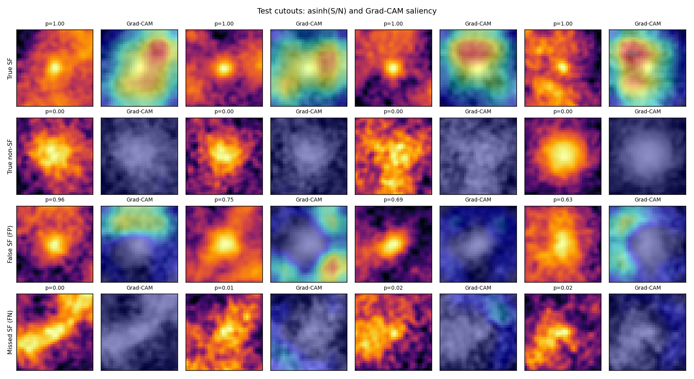

# Classifying Star-Forming and Non-Star-Forming Dense Cores in JCMT SCUBA-2 Maps with a Convolutional Neural Network

*Final Year Project: code and report*

---

## Abstract

Dense cores in molecular clouds are where stars form, but deciding whether a given core
already contains a protostar normally requires infrared observations. This project asks
whether a convolutional neural network (CNN) can make that call from submillimetre
dust-continuum data alone. Cutouts come from James Clerk Maxwell Telescope (JCMT) SCUBA-2
850 µm maps. The pipeline detects cores, labels them by cross-matching against Spitzer
young-stellar-object (YSO) catalogues, extracts unit-free 32 × 32 cutouts, and trains a
compact CNN (SFNet, 0.3 M parameters) with rotation/flip augmentation and leakage-aware
train/test splits.

The method was developed on a synthetic survey that reproduces the main features of
SCUBA-2 data (868 cores). There SFNet reached ROC-AUC 0.946 on three held-out regions.
It was then applied to real JCMT Gould Belt Survey maps of Perseus (181 labelled cores).
On the held-out Perseus cores SFNet reached ROC-AUC 0.84 and accuracy 0.84. That matches
a peak-S/N-only baseline (AUC 0.84) and falls short of a random forest on six hand-crafted
morphological features (AUC 0.93). With a sample this small, a classical feature-based model
is more reliable than a CNN. Grad-CAM saliency and the error analysis suggest the CNN mainly
learns that protostellar cores are brighter. The main limits on the result are sample size
and label noise, so more clouds are the clear next step.

---

## 1. Introduction

### 1.1 Scientific background
Stars form in dense cores (about 0.05–0.1 pc, about 10⁴–10⁵ cm⁻³) inside molecular clouds.
A central question in star formation is how long cores spend in the **starless /
prestellar** phase before a protostar forms. That timescale is estimated from the ratio of
starless to protostellar cores (e.g. Ward-Thompson et al. 2007), so it depends on
classifying large numbers of cores correctly.

Cold dust in cores emits in the submillimetre, and JCMT's SCUBA-2 camera maps this emission
at 450 and 850 µm (Holland et al. 2013). Protostars, however, are usually identified in the
mid/far-infrared from their spectral energy distributions: the spectral index α and the
bolometric temperature T_bol (Greene et al. 1994; Chen et al. 1995; Dunham et al. 2015).
If 850 µm morphology alone could predict whether a core is star-forming, the method would
work where infrared coverage is missing, confused or saturated. It would also show which
physical signatures in the dust emission trace star formation.

Physically we expect differences between the two classes:
- **Protostellar envelopes** are centrally condensed, with steep power-law density profiles
  (ρ ∝ r^-1.5 to r^-2) and a warm inner region, which makes a compact, peaked 850 µm source.
- **Starless and prestellar cores** have flatter inner profiles (close to Bonnor–Ebert).
- Outflow CO(3–2) emission can leak into the 850 µm band (Drabek et al. 2012) and add faint
  structure around protostars.

### 1.2 Aims
1. Build a reproducible pipeline from raw SCUBA-2 FITS maps to labelled training cutouts.
2. Train a CNN to classify cores as star-forming or non-star-forming.
3. Compare it fairly against classical baselines, using splits that prevent information leaking
   from training to test data.
4. Interpret what the CNN has learned (Grad-CAM) and identify its failure modes.

---

## 2. Data

### 2.1 JCMT SCUBA-2 maps
Real data are the public **JCMT Gould Belt Survey (GBS) DR3** 850 µm maps of Perseus
(Kirk et al. 2018; data DOI [10.11570/18.0005](https://doi.org/10.11570/18.0005)), reduced
with the external-mask method (`extmask`):

| map | pixels | pixel scale | units |
|---|---|---|---|
| `PerseusWest_20170815_850_DR3_ext_HK` (NGC 1333, B1, L1448, L1455) | 3956 × 2570 | 3″ | mJy arcsec⁻² |
| `PerseusIC348_20170725_850_DR3_ext_HK` (IC 348, B5) | 3050 × 2341 | 3″ | mJy arcsec⁻² |

Each file contains the map and a `VARIANCE` extension. The 850 µm effective beam is 14.1″
(Dempsey et al. 2013), which is about 0.02 pc at the Perseus distance of about 300 pc.

### 2.2 YSO catalogue
Protostar positions come from the Spitzer c2d + Gould Belt catalogue of **Dunham et al.
(2015)** (VizieR `J/ApJS/220/11`, table `fluxobs`, Cloud = Perseus; 385 YSOs). Classes were
assigned from the extinction-corrected spectral index α′ and T_bol, following Dunham et al.
(2015). This is done by [scripts/prepare_dunham2015.py](scripts/prepare_dunham2015.py).

| class | rule | N (Perseus) |
|---|---|---|
| 0 | α′ ≥ 0.3, T_bol < 70 K | 37 |
| I | α′ ≥ 0.3, T_bol ≥ 70 K | 38 |
| Flat | −0.3 ≤ α′ < 0.3 | 35 |
| II | −1.6 ≤ α′ < −0.3 | 235 |
| III | α′ < −1.6 | 39 |

### 2.3 Synthetic survey
The pipeline needed to be developed and tested before touching real data, so
[sfcnn/synthetic.py](sfcnn/synthetic.py) generates SCUBA-2-like maps. Each map contains:
- a lognormal cloud with a power-law spectrum, plus filaments;
- flat-topped starless cores;
- centrally peaked protostellar envelopes with an unresolved warm component and optional
  CO-outflow lobes;
- realistic observing effects:
  - the two-component SCUBA-2 beam (13″ main beam + 48″ error beam);
  - loss of large scales from the map-maker (simulated by a high-pass filter);
  - noise that rises towards the map edges;
  - a matching YSO catalogue with positional scatter and unrelated Class II/III stars.

Deliberately "hard" cores were added so the task is not trivial: compact prestellar cores
and faint, VeLLO-like protostars. In total there are 12 regions of 40′ × 40′ with
868 labelled cores.

---

## 3. Method

### 3.1 Core detection
Cores are local maxima of the S/N map (data / √variance). Before peak finding, the map is
smoothed with a 7″ Gaussian. A peak is kept only if it is above 5σ and at least one beam
(15″) from a brighter peak ([sfcnn/sources.py](sfcnn/sources.py)).

### 3.2 Labelling
Each peak is cross-matched with the YSO catalogue ([sfcnn/labels.py](sfcnn/labels.py)):
- **Star-forming (1):** a Class 0, I or Flat protostar within 15″ (about one beam) of the peak.
- **Non-star-forming (0):** no protostar within 30″, and no Class II/III star within 15″.
- **Ambiguous:** everything else. These cores are discarded.

The buffer zone between the two radii keeps astrometric scatter and borderline associations
from becoming label noise. Discarding cores with a Class II/III star on the peak removes
cases where an evolved or misclassified YSO overlaps a core.

| region | labelled cores | star-forming | non-SF | ambiguous (dropped) |
|---|---|---|---|---|
| Perseus West | 130 | 42 | 88 | 11 |
| Perseus IC 348 | 51 | 7 | 44 | 5 |
| **Total** | **181** | **49** | **132** | 16 |

### 3.3 Cutouts and input representation
Each core becomes a 96″ × 96″ cutout (about 7 beams, or 0.14 pc at 300 pc), resampled to a
32 × 32 grid ([sfcnn/cutouts.py](sfcnn/cutouts.py)). There are two channels:
1. **asinh(S/N / 3)**, the significance. The asinh stretch compresses the large dynamic range
   of dust emission but stays linear near the noise floor.
2. **flux / central flux**, clipped to [−1, 2]. This carries shape alone, independent of
   brightness.

Both channels are dimensionless. That is why the same code works on synthetic maps in
mJy beam⁻¹ and on GBS maps in mJy arcsec⁻², with no calibration step.

### 3.4 Network architecture
SFNet ([sfcnn/model.py](sfcnn/model.py)) is a small VGG-style CNN:

```
input 2×32×32
→ [Conv3×3-BN-ReLU ×2, 32]  → MaxPool → 16×16
→ [Conv3×3-BN-ReLU ×2, 64]  → MaxPool →  8×8
→ [Conv3×3-BN-ReLU ×2, 128]            →  8×8   (Grad-CAM layer)
→ GlobalAvgPool → Dropout(0.3) → Dense(64) → ReLU → Dropout(0.3) → Dense(1) → sigmoid
```

It has 295,489 parameters. The capacity was kept low on purpose because the real dataset
has only hundreds of examples.

### 3.5 Training
- **Loss:** binary cross-entropy, with the positive class weighted by N_neg / N_pos to
  correct for class imbalance.
- **Optimiser:** AdamW (Loshchilov & Hutter 2019), learning rate 10⁻³, weight decay 10⁻⁴,
  cosine schedule, batch size 64.
- **Augmentation:** the 8 dihedral transforms (rotations by 90° and flips), which preserve
  the label because the sky has no preferred orientation, plus random ±1 pixel shifts to
  simulate peak-position error.
- **Test-time augmentation:** predictions are averaged over the 8 dihedral transforms.
- **Model selection:** early stopping on validation ROC-AUC.
  - On Perseus, checkpoint selection is not allowed before epoch 25 (`min_epochs`), for the
    reason given in §5.3.
  - The decision threshold is chosen to maximise F1 on the validation set and is never tuned
    on the test set.

### 3.6 Avoiding data leakage
Neighbouring cores have overlapping cutouts and share a cloud environment, so a random split
would put almost the same pixels in both training and test sets and inflate the scores.
[sfcnn/dataset.py](sfcnn/dataset.py) therefore implements:
- **Region split** (synthetic data): whole maps are held out.
- **Spatial split** (Perseus, which has only 2 maps): each map is divided into 300″ blocks,
  and each block is assigned wholly to train, validation or test. A **buffer** then removes
  any training core whose cutout overlaps a held-out cutout; 10 cores were removed this way.

The Perseus split is 105 train (22 SF), 29 validation (9 SF) and 37 test (15 SF).

### 3.7 Baselines
A CNN is only worth using if it beats simpler methods. Three baselines were trained on the
same splits:
1. **Peak S/N only.** How far does brightness alone get you?
2. **Logistic regression** on six hand-crafted features ([sfcnn/features.py](sfcnn/features.py)):
   - peak S/N;
   - aperture S/N;
   - central concentration;
   - area above half-maximum;
   - axis ratio from second moments;
   - background level.
3. **Random forest** (400 trees) on the same six features.

---

## 4. Experiments
| experiment | data | split | purpose |
|---|---|---|---|
| E1 | synthetic, 12 regions, 868 cores | by region (3 test regions) | develop and validate the pipeline |
| E2 | Perseus, 181 cores | spatial blocks + buffer | real-data performance, default early stopping |
| E3 | Perseus, 181 cores | same as E2 | E2 with `min_epochs = 25` |

All runs use seed 42 on a CPU. Each training run takes a few minutes.

---

## 5. Results

### 5.1 E1: synthetic survey
Test set: 233 cores from 3 unseen regions (66 star-forming).

| model | ROC-AUC | PR-AUC | accuracy | balanced acc. | precision | recall | F1 |
|---|---|---|---|---|---|---|---|
| **SFNet (CNN)** | **0.946** | 0.909 | 0.884 | 0.864 | 0.783 | 0.818 | 0.800 |
| Random forest (features) | 0.942 | **0.914** | **0.893** | **0.870** | **0.806** | 0.818 | **0.812** |
| Logistic regression (features) | 0.902 | 0.861 | 0.863 | 0.831 | 0.758 | 0.758 | 0.758 |
| Peak S/N only | 0.661 | 0.419 | 0.524 | 0.613 | 0.353 | 0.818 | 0.493 |




### 5.2 E2 and E3: real JCMT data (Perseus)
Test set: 37 held-out cores (15 star-forming).

| model | ROC-AUC | PR-AUC | accuracy | balanced acc. | precision | recall | F1 |
|---|---|---|---|---|---|---|---|
| SFNet, E2 (default early stopping) | 0.773 | 0.739 | 0.649 | 0.673 | 0.545 | 0.800 | 0.649 |
| **SFNet, E3 (`min_epochs` = 25)** | 0.839 | 0.827 | **0.838** | 0.821 | **0.846** | 0.733 | 0.786 |
| **Random forest (features)** | **0.927** | **0.912** | **0.838** | **0.832** | 0.800 | **0.800** | **0.800** |
| Logistic regression (features) | 0.894 | 0.881 | 0.811 | 0.788 | 0.833 | 0.667 | 0.741 |
| Peak S/N only | 0.836 | 0.812 | 0.730 | 0.741 | 0.632 | 0.800 | 0.706 |

E3 confusion matrix at the validation-tuned threshold: TP = 11, FP = 2, TN = 20, FN = 4.


### 5.3 Effect of model selection (E2 vs E3)
In E2, early stopping picked **epoch 3**, because validation AUC on only 29 cores
fluctuated and an early lucky value was never beaten. That network was almost untrained:
every test probability fell between 0.46 and 0.49. Forbidding checkpoint selection before
epoch 25 (E3) moved the chosen epoch to 34. Test AUC rose from 0.77 to 0.84 and accuracy
from 0.65 to 0.84. **With small validation sets, standard early stopping is unreliable.**

---

## 6. Discussion

### 6.1 Does the CNN learn anything beyond brightness?
On real data SFNet (AUC 0.839) does no better than **peak S/N alone** (AUC 0.836), while the
random forest on morphology features does clearly better (AUC 0.927). Three observations
suggest the CNN has mostly learned that protostellar cores are brighter:
- its **Grad-CAM** maps for star-forming cores cover most of the cutout rather than the
  compact centre;
- its **false positives** are bright, smooth, extended emission with the peak off-centre;
- its **false negatives** are faint, noisy cores, including one compact isolated source at
  low S/N.

The random forest has explicit access to concentration and size. That shape information
helps, and with 105 training examples the CNN does not discover it on its own.

On synthetic data the CNN and random forest are tied (0.946 vs 0.942), and peak S/N alone
is weak (0.661). This is because the simulator separates the classes mainly by shape and
gives the two classes overlapping brightness distributions. **The difference between
synthetic and real data is itself a result.** In Perseus, brightness carries more information
than the simulator assumed, and the simulator should be recalibrated against the real
peak-flux distributions.

### 6.2 Sample size and uncertainty
The real test set has 37 cores. With 15 positives, one misclassified core changes recall by
0.07. The AUC values therefore carry uncertainties of roughly ±0.05–0.08, so the CNN–peak-S/N
difference is not significant. The random forest's lead over the CNN is suggestive but not
conclusive. Firm conclusions need either:
- repeated runs over several split seeds, reporting mean ± standard deviation, or
- more clouds (§7).

### 6.3 Label quality
- **Incompleteness.** Spitzer misses some deeply embedded or very low-luminosity Class 0
  sources, so a few "non-star-forming" labels are probably wrong.
- **Projection.** A protostar seen in projection near a starless core produces a false
  "star-forming" label.
- **Classification boundaries.** Classes from α′ have uncertain boundaries: Flat-spectrum
  sources may be envelope-free and seen at certain inclinations.

Herschel-based protostar catalogues, or the HOPS sample in Orion (Furlan et al. 2016),
would reduce these problems.

### 6.4 What counts as a "core"
The 5σ peak finder also picks up local maxima along filaments (visible as many of the true
negatives in the Grad-CAM figure). This makes the non-star-forming class a mix of genuine
starless cores and filament fragments. Using a published GBS core catalogue (the
`source_catalog` option) would give a cleaner, physically defined sample.

### 6.5 Calibration
The validation-tuned threshold in E3 is very low (0.05), and the reliability diagram is far
from the diagonal. So the CNN's outputs are rankings, not calibrated probabilities. If
probabilities are needed, e.g. for population counts and lifetime estimates, temperature
scaling or isotonic regression on the validation set would fix this.

### 6.6 Physical scale
A fixed 96″ cutout corresponds to 0.14 pc in Perseus but 0.19 pc in Orion. Training across
clouds at different distances would need cutouts of fixed *physical* size.

---

## 7. Conclusions and future work

### Conclusions
1. A complete, tested pipeline now runs from JCMT SCUBA-2 FITS maps and YSO catalogues to a
   trained classifier, with leakage-aware evaluation and saliency maps.
2. On a realistic synthetic survey, a compact CNN reaches ROC-AUC 0.95 on unseen regions.
3. On real JCMT Gould Belt Survey data in Perseus (181 cores), the CNN reaches ROC-AUC 0.84
   and accuracy 0.84.
   - This matches a peak-S/N baseline.
   - It is below a random forest on morphology features (AUC 0.93).
   - At this sample size, classical features are the better choice.
4. With small validation sets, model selection needs care: a minimum number of epochs
   changed test AUC from 0.77 to 0.84.

### Future work
- **More data.**
  - The Dunham et al. (2015) catalogue also covers Serpens/Aquila, Ophiuchus, Auriga,
    Cepheus, IC 5146, Corona Australis and Lupus, all of which have GBS DR3 maps.
    Adding them should give roughly 5× more cores, and would allow leave-one-cloud-out
    testing.
  - Orion A/B, with the HOPS/Megeath catalogues, would add hundreds more.
- **Repeated splits.** Report mean ± standard deviation over 5–10 split seeds.
- **Hybrid model.** Feed the hand-crafted features into the CNN's dense layers, or use the
  CNN embedding as extra random-forest features.
- **Additional channels.** Add 450 µm (a temperature and dust-emissivity proxy). 70 µm should
  not be used, because it is what identifies protostars in the first place and would leak
  the label.
- **Physical-scale cutouts, and calibrated probabilities** for core-lifetime statistics.
- **Recalibrate the simulator** against the observed Perseus peak-flux and size distributions.

---

## References
*Check each reference against NASA ADS before submission.*

- Chen H. et al. 1995, ApJ, 445, 377: bolometric temperature classification
- Dempsey J. T. et al. 2013, MNRAS, 430, 2534: SCUBA-2 calibration and beam
- Drabek E. et al. 2012, MNRAS, 426, 23: CO(3–2) contamination of SCUBA-2 850 µm
- Dunham M. M. et al. 2015, ApJS, 220, 11: YSOs in the Gould Belt (VizieR J/ApJS/220/11)
- Furlan E. et al. 2016, ApJS, 224, 5: HOPS protostars in Orion
- Greene T. P. et al. 1994, ApJ, 434, 614: spectral-index classes
- Holland W. S. et al. 2013, MNRAS, 430, 2513: SCUBA-2 instrument
- Kirk H. et al. 2018, ApJS, 238, 8: JCMT GBS data reduction and DR (doi:10.11570/18.0005)
- Loshchilov I. & Hutter F. 2019, ICLR: AdamW
- Selvaraju R. R. et al. 2017, ICCV: Grad-CAM
- Ward-Thompson D. et al. 2007, PASP, 119, 855: the JCMT Gould Belt Survey

---

## Appendix A: Reproducing the results

### Setup
```bash
python -m venv C:\venvs\sfcnn
```
```bash
C:\venvs\sfcnn\Scripts\activate
```
```bash
pip install -r requirements.txt
```
```bash
python -m pytest tests
```
On Windows, keep the virtualenv at a short path. Otherwise astropy can fail with
*"DLL load failed … filename or extension is too long"*.

### E1: synthetic
```bash
python -m sfcnn demo
```

### E2/E3: Perseus (real data)
Download into `data/real/` (about 125 MB; `data/` is git-ignored).

1. GBS DR3 maps, from
   `https://www.canfar.net/storage/list/AstroDataCitationDOI/CISTI.CANFAR/18.0005/data/DR3_public_release/Perseus/extmask`:
   `PerseusWest_20170815_850_DR3_ext_HK.fits.gz` and `PerseusIC348_20170725_850_DR3_ext_HK.fits.gz`.
2. The Dunham et al. 2015 YSOs, as a TSV from VizieR (URL in
   [scripts/prepare_dunham2015.py](scripts/prepare_dunham2015.py)), saved as
   `data/real/dunham2015_perseus.tsv`.

Then run:
```bash
python scripts/prepare_dunham2015.py data/real/dunham2015_perseus.tsv data/real/perseus_ysos.csv
```
```bash
python -m sfcnn -c configs/perseus.yaml build
```
```bash
python -m sfcnn -c configs/perseus.yaml train
```
```bash
python -m sfcnn evaluate --checkpoint runs/perseus_min25/best.pt
```
For E2, remove `min_epochs` from `configs/perseus.yaml` and change `run_dir`.

### Applying a trained model to a new map
```bash
python -m sfcnn classify --checkpoint runs/perseus_min25/best.pt --map path/to/map.fits
```
```bash
python -m sfcnn probmap --checkpoint runs/perseus_min25/best.pt --map path/to/map.fits
```

## Appendix B: Code layout
```
sfcnn/
  fits_io.py     SCUBA-2 FITS loading (cube squeeze, VARIANCE, WCS)
  sources.py     peak finding / external core catalogues
  labels.py      YSO cross-match labelling
  cutouts.py     resampled cutouts + 2-channel normalisation
  dataset.py     dataset building, leakage-free splits, augmentation
  model.py       SFNet, test-time augmentation, checkpoint loading
  train.py       training loop
  evaluate.py    metrics, baselines, plots
  features.py    hand-crafted features for the baselines
  explain.py     Grad-CAM
  predict.py     classify new maps, probability maps
  synthetic.py   synthetic SCUBA-2 survey generator
  __main__.py    command-line interface
scripts/prepare_dunham2015.py   VizieR YSO table → sfcnn CSV with classes
configs/         default (synthetic), perseus (real data), manifest templates
docs/figures/    figures used in this report
tests/           pytest suite
```
